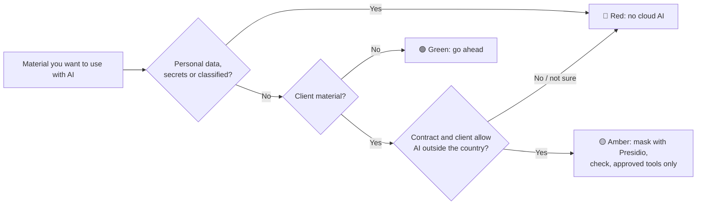

# AI Data Safety Lab

**Hands-on labs for masking personal data with [Presidio](https://github.com/data-privacy-stack/presidio) before it reaches an AI tool.**

From the *Data safety and Presidio* session of FPT Middle East's **AI in Everyday Delivery** programme (24 November 2026).

> **Everything here is synthetic.** DemoTel is a fictional GCC telecom. Every name, ID, phone number, IBAN, card and email in this repository is invented. Never put real client or customer data in this repository, in an issue, or in a pull request.

## What you will learn

| Lab | You will | Time |
| --- | --- | --- |
| [Setup](SETUP.md) | Install uv, download Presidio, run your first mask | 15 min |
| [1. Mask a text file](labs/01-mask-text.md) | Mask workshop notes and find what Presidio missed | 10 min |
| [2. Mask a Word document](labs/02-mask-word.md) | Mask a real `.docx`, keep its layout, spot the Arabic gap | 10 min |
| [3. Fix the misses](labs/03-fix-the-misses.md) | Add a deny list and tune the threshold | 15 min |
| [4. Which colour?](labs/04-which-colour.md) | Classify ten items as green, amber or red | 10 min |
| [5. The Claude Code guard](labs/05-claude-code-guard.md) | Block prompts that contain personal data, automatically | 10 min (optional) |

## Quick start

```bash
git clone https://github.com/sudoalgorithm/ai-data-safety-lab.git
cd ai-data-safety-lab
uv run presidio/show_mask.py samples/stakeholder-notes.md
```

No uv yet? Start with [SETUP.md](SETUP.md).

## The rule in one picture



Not sure? Take the higher colour and ask your delivery manager.

## What is in here

| Path | What it is |
| --- | --- |
| `presidio/gcc_presidio.py` | Presidio set up with recognisers for GCC IDs (Emirates ID, Saudi ID and Iqama, Qatar QID, Kuwait, Oman and Bahrain IDs) and GCC mobile numbers |
| `presidio/mask.py` | Mask a text file; prints the masked text |
| `presidio/show_mask.py` | The view from the session: findings highlighted, a table with confidence, then the masked text |
| `presidio/mask_docx.py` | Mask a Word document; writes a `.found.docx` (findings in red) and a `.masked.docx` (layout kept) |
| `presidio/pii_guard.py` | A Claude Code hook that blocks prompts containing personal data |
| `samples/` | Synthetic DemoTel material to practise on |
| `labs/` | The exercises |

## Important limits

- Presidio **misses things**, especially **Arabic names**, first names on their own, and text inside images. Always read the result.
- Masking covers the text you pass through it. It does **not** stop an AI assistant from reading files open in your editor.
- These scripts are a starting point for training. Before using them on client work, follow your project's data rules and get approval from your delivery manager.
