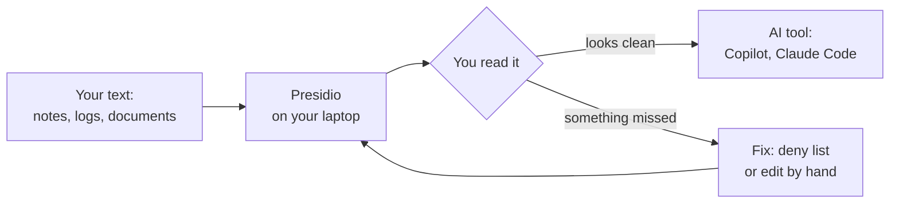

# Putting Presidio in front of your AI tool

Presidio only protects you if it runs **before** text reaches the AI. This guide sets that up for the tools in the programme.



| Tool | How Presidio sits in front of it | Automatic? |
| --- | --- | --- |
| **GitHub Copilot** (VS Code) | Mask the clipboard with one key, then paste. Give Copilot masked *copies* of files, never the originals. | No: it is a habit, made one key long |
| **Claude Code** | A hook checks every prompt and **blocks** it if it contains IDs, phones, emails, IBANs or cards | Yes, for what you type |
| **FPT AI gateway** (proposed) | Masks every request from every connected tool | Yes, when it exists |
| Personal ChatGPT, Gemini, Claude.ai and other consumer apps | Not allowed for client material, masked or not | n/a |

Copilot cannot be routed through a gateway or a hook, which is why the habit matters.

---

## 1. GitHub Copilot in VS Code

### 1a. One key to mask the clipboard

This repository includes VS Code tasks in `.vscode/tasks.json`. Open the **repository folder** in VS Code (File → Open Folder), then:

1. Copy the text you want to give Copilot.
2. **Terminal → Run Task… → Presidio: mask clipboard**.
3. Read the summary in the terminal panel, then paste into Copilot Chat. You are pasting the masked version.

**Bind it to a key** so it becomes a reflex:

1. Press **Ctrl+Shift+P** (Mac: **Cmd+Shift+P**) → **Preferences: Open Keyboard Shortcuts (JSON)**.
2. Add this inside the `[ ]`:

   ```json
   {
     "key": "ctrl+alt+m",
     "command": "workbench.action.tasks.runTask",
     "args": "Presidio: mask clipboard"
   }
   ```

   On a Mac, use `"cmd+alt+m"`.
3. Save. Now: **copy → Ctrl+Alt+M → paste**.

The tasks run from this folder. To use them in your own project, copy the `presidio` folder and `.vscode/tasks.json` into that project, or use the terminal commands below.

**From any terminal:**

| Windows (PowerShell) | macOS / Linux |
| --- | --- |
| `uv run presidio\mask_clipboard.py` | `uv run presidio/mask_clipboard.py` |

### 1b. Give Copilot masked copies of files, never the originals

Copilot **agent mode reads files in your workspace** to build context. Masking what you paste does not help if the original sits in the open folder.

1. Keep raw material **outside** the folder you open in VS Code. For example, keep `C:\clients\raw\` separate from `C:\clients\project\`.
2. Make a masked copy:
   - Text files: open the file, then **Run Task → Presidio: save a masked copy of this file**. It writes `work/masked/<name>`.
   - Word files: **Run Task → Presidio: mask this Word document**. It writes `.found.docx` and `.masked.docx` into `work/masked/`.
3. Read the masked copy, then point Copilot at it, for example `#file:work/masked/notes.md`.

### 1c. Copilot settings that help (organisation admins)

These are set by your Copilot administrator, not in this repository:

- **Content exclusion** for folders such as `data/`, `secrets/` and `.env`. It is **not honoured in agent or edit mode**, so it does not replace keeping red data out of the workspace.
- Claude models covered by zero data retention; models that retain data switched off for amber work.
- Block suggestions that match public code.

---

## 2. Claude Code: block personal data automatically

A `UserPromptSubmit` hook runs `presidio/pii_guard.py` every time you press Enter. If the prompt contains an ID, phone number, email, IBAN or card, Claude Code **blocks it before it is sent** and shows you why.

### Set it up (Windows, macOS and Linux)

1. In the project folder, copy the example settings:

   | Windows (PowerShell) | macOS / Linux |
   | --- | --- |
   | `Copy-Item .claude\settings.example.json .claude\settings.local.json` | `cp .claude/settings.example.json .claude/settings.local.json` |

   The file contains:

   ```json
   {
     "hooks": {
       "UserPromptSubmit": [
         {
           "hooks": [
             {
               "type": "command",
               "command": "uv",
               "args": ["run", "-q", "${CLAUDE_PROJECT_DIR}/presidio/pii_guard.py"],
               "timeout": 60
             }
           ]
         }
       ]
     }
   }
   ```

   It runs `uv` directly with arguments, not through a shell. That works the same on Windows **with or without Git Bash**, and `${CLAUDE_PROJECT_DIR}` points at the project folder wherever Claude Code is working.

2. Start Claude Code in the project folder (`claude`) and send `hello`. The first guarded prompt takes about 15 seconds while Presidio loads; later prompts take about 5.

3. Test it:

   | Prompt | Expected |
   | --- | --- |
   | `Write a test case for customer 784-1985-7654321-2` | Blocked: `AE_EMIRATES_ID` |
   | `Write a test case for a customer with a synthetic Emirates ID` | Goes through |

**Windows notes**

- `uv` must be on your PATH for Claude Code. If `uv --version` works in a new PowerShell window, it works for the hook. If the hook says `uv` was not found, restart Claude Code after installing uv, or sign out and back in.
- Set `PYTHONUTF8=1` permanently (see [WINDOWS.md](WINDOWS.md#make-utf-8-permanent)) so Arabic prompts are handled correctly.

**Using it in your own project:** copy the `presidio` folder into the project and add the hook to that project's `.claude/settings.local.json` (just you) or `.claude/settings.json` (the whole team). If you create `settings.local.json` by hand, add it to `.gitignore`.

**What it does not do:** it checks what you type, not files Claude Code reads. Protect files by keeping red data out of the project and by adding `deny` rules to the settings, for example:

```json
"permissions": { "deny": ["Read(./.env)", "Read(./.env.*)", "Read(./secrets/**)", "Read(./data/**)"] }
```

Names are not blocked on purpose: requirements and test cases mention people all the time, and a guard that blocks normal work gets switched off.

---

## 3. Your own deny list

Every project has names the model will miss: first names on their own, Arabic names, a client's staff, project code names. Keep a list and use it everywhere:

```text
# work/my-names.txt: one per line
Huda
Omar
خالد
المنصوري
```

```powershell
uv run presidio\mask_clipboard.py --deny work\my-names.txt
uv run presidio\mask_docx.py report.docx --outdir work\masked --deny work\my-names.txt
```

Keep the list itself out of git: it is personal data too. The `work/` folder is already ignored.

---

## 4. Before every paste: the 10-second check

1. **What colour is it?** Green: go ahead. Amber: mask first. Red: stop.
2. **Masked?** Run it through Presidio.
3. **Read it.** Names on their own, Arabic text, made-up email formats, and anything in images are the usual misses.
4. **Right tool?** An approved tool with the right settings, never a personal account.

Something slipped through anyway? Tell your delivery manager the same day. No blame: the sooner we know, the more we can limit it.
